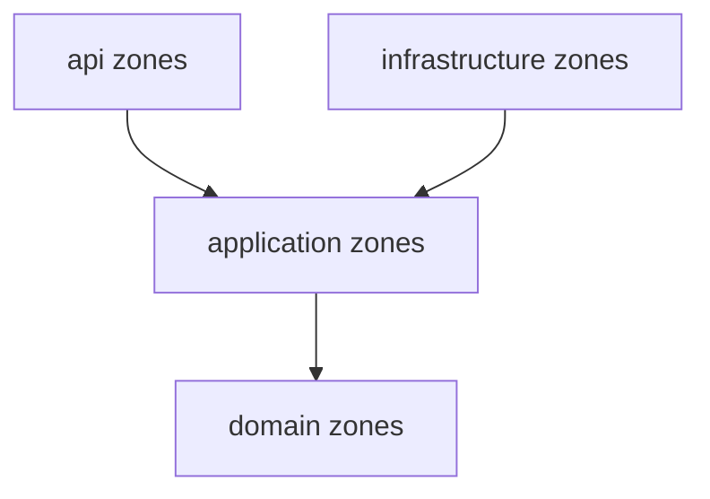

# EarthTrend Detective — план бекенду

Один процес на **Litestar**, зібраний як **Clean Architecture** і **Ports and Adapters**. Код лежить у чотирьох шарах: `domain`, `application`, `infrastructure`, `api`. У кожному шарі одні й ті самі зони DDD — це папки, а файли лежать уже в папці зони. Наука живе в окремому пакеті аналітики і заходить у бекенд лише через порт.

Зони: `catalog`, `cases`, `radar`, `story`, `assistant`, `jobs`, `exports`, `tiles`, `journal`, `education`, `identity`. Папка `shared` у шарі тримає лише те, що немає власної зони: годинник, id, сесію SQLAlchemy, кеш, шину подій, клієнт аналітики, мапінг помилок. `health` є зоною в `application` і `api`.

Залежності дивляться всередину:

1. **domain** нічого не імпортує з інших шарів і з фреймворків.
2. **application** імпортує `domain` і порти своєї зони. Порт зони оголошений у `application/<зона>/ports.py`, спільний порт — у `application/shared/`.
3. **infrastructure** імпортує `application` і реалізує порти. SQLAlchemy, httpx, Anthropic і файли живуть у `infrastructure/<зона>/`.
4. **api** імпортує `application`. Litestar, DTO, guards і SSE живуть у `api/<зона>/`. Роутер зони викликає use case тієї самої зони.
5. **api/app.py** — єдина точка, яка імпортує `infrastructure`, створює реалізації портів і передає їх у use cases.



## Контракт із сусідами

Аналітика віддає моделі `TrendResult`, `EvidenceProtocol`, `GridTrendProduct`, `RadarEntry`, `StoryFacts`, `AiOpinion`, `TrendPotential`, `VerticalProfile`, `UrbanContrast`, `TypologyMap`. Бекенд їх не перераховує: зберігає, кешує і віддає фронтенду під `/api/v1`. Фронтенд малює ці поля і перекладає коди вироку, застережень і патернів. Текст історії й асистента збирає бекенд із `StoryFacts`. Порівняння регіонів бекенд збирає з уже порахованих справ, не з нової формули.

## Функціональна ціль

Ціль продукту — розділи 3–6 і 9 документа `docs/BEST_IMPLEMENTATION.md`. Стек цього плану лишається Litestar, чотири шари і префікс `/api/v1`. Наука лишається в пакеті аналітики.

| Пункт BEST | Де живе |
|---|---|
| Вибір змінної, теми, паспорт, семантичний пошук | `ListVariables`, `GetVariable` |
| Розширений каталог NASA CMR на вимогу | `SearchCmr`. Готовий паспорт віддається одразу. Завантаження і аналіз ідуть важкою задачею |
| Регіони AR6, країни, області, басейни, біоми, міста з кільцем, океан, висотні пояси | `ListRegions`, `GetRegion` |
| Полігон, GeoJSON, точка і радіус | `RegisterCustomRegion`. Маску і площу рахує аналітика |
| Ряд, аномалії, STL, GAM, 12 місяців, сезони, точки зламу | `GetCase` віддає `SeriesArtifact` |
| Карта тренду і кадр анімації за роком | `GetTile`. Палітра і штрихування значущості малює фронтенд |
| Вирок і шість доказів плюс дорадчий `ai_expert` | `GetEvidence` |
| Свідки, трикутник, алібі, якість, роки до доказу, розкол | пункти протоколу і поля ряду. Бекенд числа не рахує |
| Вертикальний профіль, місто проти околиць | `GetProfile`, `GetUrbanContrast` |
| Порівняння 2–4 регіонів | `CompareCases` |
| Стрічки радару і типологія схожих змін | `GetRadarFeed`, `GetRadarTypology`. Оновлення після нових місяців — новий продукт аналітики |
| Граф процесів, лаги, патерни, алібі, свідки, статті | `BuildStory`. Числа лише з фактів |
| План розслідування і відповідь з id справи | `AskAssistant`, `StreamAssistant` |
| Навчальний режим без готового вироку | `mode=teach` у тих самих маршрутах асистента |
| Демо з кроками, словник, завдання, вікторини, лабораторія, бейджі | зона `education`. Симулятор кличе аналітику |
| Журнал справ, нотатки, гіпотези | зона `journal` |
| CSV, GeoJSON, notebook, HTML, PNG, PDF, ZIP, NetCDF, SVG, цитування з DOI | `CreateExport` |
| Повний стан справи в посиланні | id справи вже несе специфікацію, період, методи і версії |
| Текст графіка для читача екрана | поле `alt_text` у справі, зібране з фактів |
| Режим «Просто» і «Експерт», палітри, телефон | фронтенд. Бекенд завжди віддає повний протокол |
| Сім демо-справ розділу 9 | `DemoScenario` у каталозі |

## 1. Роль

Бекенд:

- приймає HTTP, валідує DTO і перекладає їх у команди use case;
- дає кожній справі стабільний ID, специфікацію, версії даних і результат, щоб аналіз відкривався знову і шарився посиланням;
- на швидкий аналіз відповідає в тому самому запиті, на важкий ставить job і віддає прогрес через SSE та polling;
- кешує каталог, регіони, радар, готові справи, протоколи доказів, історії, тайли, дозволені відповіді асистента і метадані експорту;
- веде журнал з нотатками і гіпотезами, демо-справи з кроками, словник, завдання, відповіді учнів, вікторини, лабораторію і бейджі;
- збирає текст асистента і Story Lens із `StoryFacts`: спершу M4, якщо модель пройшла ворота, інакше шаблон, інакше Anthropic;
- читає куб і живий шлях NASA POWER / earthaccess, готує масиви і передає їх в аналітику;
- малює PNG-тайли з `GridTrendProduct` і пише файли експорту з таблиць результату.

Аналітиці належать: контроль якості, стабільна маска, десезоналізація, STL, GAM, OLS з `n_eff`, Mann-Kendall, сезонний MK, Sen's slope, bootstrap CI, jackknife, роки до значущості, точки зламу, свідки, трикутник, алібі, FDR, тренди по сітці, зони, типологія, вертикальний профіль, місто проти околиць, зважування за площею `cos φ`, вирок `verdict_rules_v1`, факти історії разом із графом і патернами, інференс M1–M3 і необов’язковий M4. Навчання моделей — CLI `earthtrend ml` у пакеті аналітики. Завантаження NASA, регрид, Zarr, HTTP, кеш, PNG і файли експорту аналітика не робить.

## 2. Домен

Сутності:

| Сутність | Що тримає |
|---|---|
| `VariablePassport` | id, рівень `curated` або `cmr`, назви EN/UA, `kid_description`, джерело, провайдер, одиниці, нативна і кубова роздільність, покриття, домен, теми, придатні типи регіонів, пов’язані id, свідки, очікуваний знак, `min_years_for_trend`, застереження, DOI або URL |
| `ProcessLink` | ребро графа: від якої змінної до якої, і в який бік вплив. Лежить у каталозі, не окремий корінь |
| `SensorEvent` | запуск, деградація або зміна версії приладу. Лежить у каталозі і годує пункт якості |
| `Region` | id, назва, тип, геометрія, bbox, кільце околиць для міста, площа, статус реєстрації |
| `Case` | id, власник, специфікація, статус, вирок, версії, хеш результату, посилання на артефакти |
| `CaseSpec` | змінна, регіон, період, сезон, частота, мова, опції, версії даних |
| `Verdict` | код `verdict_rules_v1`, `strength` 0–100, `ruleset`, заголовок, короткий текст, напрям, `caveats` |
| `EvidenceProtocol` | сім пунктів і вирок |
| `AiOpinion` | версія M1, клас зміни, ймовірності, нахил і інтервал, впевненість, згода зі статистикою |
| `TrendPotential` | змінна, сезон, ймовірність значущості, очікуваний знак і SNR, коди причин, версія M2 |
| `SeriesArtifact` | сирий ряд, аномалії, STL, лінія тренду, GAM і позначка прискорення, 95% CI, 12 місяців, сезони, аномальні роки, точки зламу, `alt_text` |
| `VerticalProfile` | тренд на рівнях тиску. Читання справи, не новий корінь |
| `UrbanContrast` | тренд міста, тренд кільця і їхня різниця. Читання справи, не новий корінь |
| `RadarItem` | стрічка, змінна, регіон, нахили, SNR, p, q FDR, розкол, оцінка, рівень вироку, URL справи |
| `TypologyCluster` | назва патерну знаків і геометрія схожих клітинок. Читання радару, не новий корінь |
| `Story` | заголовок, текст, співучасники, статті, застереження, версії |
| `StoryFacts` | факти з аналітики до будь-якого тексту: тренд, граф, лаги, часткові кореляції, патерни, алібі, свідки |
| `Job` | id, справа, вид, статус, прогрес, етап, повідомлення, помилка |
| `Note` | автор, справа, вид `note` або `hypothesis`, текст |
| `Assignment` | вчитель, справи, текст, посилання для класу |
| `Submission` | учень, завдання, справа, відповідь |
| `Quiz` | питання, варіанти, правильна відповідь, код бейджа. Корінь освіти поруч із завданням |
| `LabRun` | параметри симулятора і порахований ряд. Тимчасове читання, не збережений агрегат |
| `Badge` | користувач, код, причина |
| `ExportRecord` | справа, формат, статус, шлях до файлу, текст цитування |
| `User` | id, роль, облікові дані |

Доменні правила:

- Статуси справи: `queued`, `running`, `completed`, `failed`. Готова справа має вирок і хеш результату. Важка справа народжується як `queued` разом із job.
- Статуси job: `queued` → `running` → `completed` або `failed`. `cancelled` можливий із `queued` і `running`. Повторна відміна завершеної джоби — доменна помилка.
- Видалити справу може власник або `admin`. Справу, на яку спирається завдання вчителя, видаляє лише `admin`.
- Справа гостя тимчасова: вона живе за id і відкривається за посиланням, у журнал і в список збережених справ не потрапляє.
- Вирок, p-value, нахили і роки до значущості домен не обчислює. Він приймає вже порахований `Verdict` і `EvidenceProtocol` і відмовляється зберегти справу зі статусом `completed` без них.
- Текст історії та асистента проходить перевірку: кожне число в тексті є в `StoryFacts`, `CaseResult` або `EvidenceProtocol`. Змінна поза каталогом у план інструментів не потрапляє.
- Ключ відтворення справи складається зі специфікації, `catalog_version`, `datasets_version` (колекція на кожну змінну) і `algorithm_version`.

Код вироку приходить з аналітики як `verdict_rules_v1`: `proven`, `strong`, `likely`, `suspicious`, `no_evidence`, `inadmissible`. Бекенд зберігає код, `strength`, `ruleset` і `caveats` (`short_record`, `many_gaps`, `low_stable_coverage`, `possible_artifact`, `methods_disagree`, `witnesses_disagree`, `period_sensitive`, `influential_year`, `explained_by_enso`, `index_trend_overlap`, `long_memory`, `ratio_not_applicable`, `split_region`, `ai_disagrees`). Розкол регіону — це `split_region`, коли обидві значущі частки площі ≥ 10%. Пункт `ai_expert` має `advisory = true` і в правила вироку v1 не входить.

Протокол доказів, який бекенд віддає як є:

| Пункт | Зміст у `details` |
|---|---|
| `statistics` | статус, `p_mk`, `p_ols`, сезонний MK; для скошених рядів вирішує MK |
| `magnitude` | нахил за десятиліття, відсоток лише при `ratio_scale`, SNR: слабкий < 0.2, помірний 0.2–0.5, сильний > 0.5 |
| `witnesses` | `WitnessesResult`: датасети одного `concept_id`, знак, тест ряду різниць |
| `robustness` | `TriangleResult`: частки вікон одного знаку |
| `alibi` | `AlibiResult`: `b_raw`, `b_adjusted`, ряд без алібі, індекси Niño 3.4, NAO, вулканічна AOD |
| `quality` | пропуски, `stable_fraction`, `n_eff`, `influential_year`, точки зламу, попередження |
| `ai_expert` | `AiOpinion`; дорадчий, на `strength` не впливає |

Панель довіри: джерело і версія колекції, період, число місяців і `n_eff`, частка пропусків, `stable_fraction`, метод, тести, 95% CI, `ruleset`, версії моделей.

`SeriesArtifact` містить сирий ряд і аномалії, STL, лінію тренду, GAM із позначкою прискорення, 95% CI, стовпчики дванадцяти місяців і сезонів DJF/MAM/JJA/SON, `JackknifeResult`, Sen's slope, нахил за десятиліття, OLS з `n_eff`, Mann-Kendall, сезонний MK, SNR, роки до значущості, `changepoints`, `split_flag`, частки площі, зони, `ai_opinion` і `alt_text`. У режимі `expert` додаються таблиця тестів і bootstrap CI. Сітка лежить у `GridTrendProduct` (`slope`, `sig_fdr`, `ai_class`, `ai_step_prob`); PNG з неї збирає шар тайлів. Кадр анімації — той самий тайл із роком. `VerticalProfile` і `UrbanContrast` аналітика рахує окремо, бекенд лише віддає.

## 3. Порти

Порт зони лежить у `application/<зона>/ports.py`. Use case залежить від інтерфейсу. Файл у `infrastructure/<зона>/` його реалізує.

| Порт | Обов’язок | Файл |
|---|---|---|
| `CaseRepository` | зберегти, прочитати, список, видалити справу | `infrastructure/cases/sqlite_case_repository.py` |
| `JobRepository` | черга і стан job | `infrastructure/jobs/sqlite_job_repository.py` |
| `JournalRepository` | нотатки і збережені справи | `infrastructure/journal/sqlite_journal_repository.py` |
| `EducationRepository` | демо-прогрес, завдання, відповіді, бейджі | `infrastructure/education/sqlite_education_repository.py` |
| `ExportRepository` | запис експорту | `infrastructure/exports/sqlite_export_repository.py` |
| `UserRepository` | користувач і роль | `infrastructure/identity/sqlite_user_repository.py` |
| `ApiKeyRepository` | ключі адміна | `infrastructure/identity/sqlite_api_key_repository.py` |
| `AuditLog` | слід адмін-дій | `infrastructure/identity/sqlite_audit_log.py` |
| `CatalogPort` | паспорти, регіони, демо, словник, граф зв’язків, версія каталогу | `infrastructure/catalog/file_catalog.py` |
| `DataPort` | куб, живий NASA POWER / earthaccess, масиви для аналізу | `infrastructure/shared/data_loader.py` |
| `AnalyticsPort` | аналіз, докази, радар, факти історії, потенціал M2, ембединги M3, `GridTrendProduct` | `infrastructure/shared/analytics_client.py` |
| `TileRenderer` | PNG із `GridTrendProduct` | `infrastructure/tiles/png_tile_renderer.py` |
| `ExportRenderer` | файл із таблиць результату | `infrastructure/exports/file_export_writer.py` |
| `CachePort` | get/set за версійним ключем | `infrastructure/shared/memory_file_cache.py` |
| `ObjectStorage` | байти експорту і тайлів | `infrastructure/shared/local_storage.py` |
| `LlmPort` | текст із фактів і планом інструментів | `infrastructure/assistant/anthropic_llm.py` |
| `TemplateNarrator` | текст із фактів без мережі | `infrastructure/story/template_narrator.py` |
| `EventBus` | прогрес і шматки відповіді для SSE | `infrastructure/shared/in_process_event_bus.py` |
| `JobRunner` | поставити важку роботу в executor | `infrastructure/jobs/process_pool_runner.py` |
| `Clock` | UTC-час | `infrastructure/shared/system_clock.py` |
| `IdGenerator` | id справи, job, експорту, регіону | `infrastructure/shared/uuid_ids.py` |
| `TokenIssuer` | випустити і прочитати JWT | `infrastructure/identity/pyjwt_token_issuer.py` |
| `PasswordHasher` | хеш пароля | `infrastructure/identity/argon2_password_hasher.py` |

`AnalyticsPort` приймає і віддає:

| Виклик | Результат |
|---|---|
| масиви і `CaseSpec` | `CaseResult`: вирок, сім пунктів, `ai_opinion`, артефакти, версії |
| протокол | `EvidenceProtocol` |
| сітка | `GridTrendProduct` |
| радар | сторінка `RadarItem` |
| історія | `StoryFacts`: коди патернів і числа |
| регіон | список `TrendPotential` |
| текст запиту | ранжовані id змінних M3, коли модель активна |
| прогрес | ціле `progress`, етап, текст |
| збій | код, текст, `retryable` |

Пакет `contracts/` у корені монорепо — мова між `infrastructure/shared/analytics_client.py`, пакетом аналітики, фронтендом і контрактними тестами. Модулі: `case`, `evidence`, `verdict`, `variable`, `region`, `radar`, `story`, `assistant`, `job`, `export`, `tile`. Use case цими модулями не користується. Клієнт аналітики перекладає `contracts` у доменні типи і назад.

## 4. Use cases

Кожен use case — одна дія: команда на вході, порти, результат. Файл use case лежить у `application/<зона>/`. Роутер у `api/<зона>/` лише збирає команду з запиту і роль із JWT.

### Каталог і регіони

| Use case | Команда | Порти | Результат |
|---|---|---|---|
| `ListVariables` | `q`, `theme`, `domain`, `seasonal`, `has_precomputed`, рівень `curated` або `cmr`, сторінка | `CatalogPort`, `AnalyticsPort`, `CachePort` | сторінка паспортів; `q` іде в M3, якщо модель активна, інакше в текст каталогу |
| `GetVariable` | id | `CatalogPort`, `CachePort` | повний паспорт, свідки і ребра графа |
| `SearchCmr` | текст запиту, актор | `CatalogPort`, `DataPort`, `JobRepository` | якщо паспорт уже є, одразу id. Інакше важка задача: завантаження на вимогу і аналіз тими самими функціями |
| `ListRegions` | `q`, `type`, `country`, `bbox`, сторінка | `CatalogPort`, `CachePort` | сторінка регіонів |
| `GetRegion` | id | `CatalogPort` | один регіон |
| `GetRegionPotential` | id регіону | `AnalyticsPort`, `CachePort` | підказки M2: змінна, сезон, ймовірність, знак, коди причин |
| `RegisterCustomRegion` | назва, GeoJSON, прямокутник або точка з радіусом, актор | `CatalogPort`, `IdGenerator` | id, назва, bbox, площа, статус `registered` |

Типи регіонів: `ar6`, `country`, `admin`, `basin`, `biome`, `city`, `ocean`, `elevation`, `demo`, `custom`. Місто тримає кільце околиць. У каталозі лежать регіони IPCC AR6, країни, області, басейни, біоми, міста, океанські басейни і демо-місця: Сахель, Амазонія, Індо-Гангська рівнина, схід США, Арктика, Антарктида, Україна, Каліфорнія. Далі справа посилається на `region_id`. Площу, маску з частковим перекриттям і вибір роздільності рахує аналітика, коли регіон потрапляє в `CaseSpec`. Кураторський набір — паспорти з темами, свідками, графом процесів і журналом подій сенсорів. Розширений рівень — пошук NASA CMR. Сім демо-справ з `docs/BEST_IMPLEMENTATION.md` лежать у каталозі як `DemoScenario` з кроками.

### Створення справи

`CreateCase`. Команда: `variable_id`, `region_id`, період (`start`, `end`), сезон (DJF/MAM/JJA/SON або весь рік), частота, мова, актор і опції.

Опції: `include_evidence`, `include_story`; режим `simple` / `expert`; джерело `auto` / `precomputed` / `live`; сценарій (прибрати рік за jackknife, лише сезон, інший період); `compare_region_ids` для двох, трьох або чотирьох регіонів поруч. Масиви для `live` і для промаху `auto` читає `DataPort`. В аналітику йде вже зібраний ряд.

Кроки:

1. `CatalogPort` підтверджує змінну і регіон. Невідомий id дає доменну помилку `variable_not_found` або `region_not_found`. Період коротший за правило паспорта дає `period_too_short`.
2. `Clock` і версії з каталогу збирають `CaseSpec`. `IdGenerator` видає id справи.
3. Ключ кешу: хеш специфікації плюс `catalog_version`, `datasets_version`, `algorithm_version`. `CachePort` шукає готовий результат.
4. Влучання в кеш: зібрати `Case` зі статусом `completed`, зберегти через `CaseRepository`, повернути справу. Гість отримує тимчасову справу без запису в журнал.
5. Швидкий режим (пресет, продукт уже є) і обчислювальний (свій полігон, нестандартний період, сезон, порівняння): `DataPort`, потім `AnalyticsPort` у цьому запиті. Орієнтир швидкого шляху — під 200 мс з продукту; пресетна справа цілком — під 2 с. Повний розрахунок із готового ряду в аналітиці цілиться в 300 мс. Обчислювальний запит лишається відкритим на час роботи.
6. Важкий режим (повна сітка, великий регіон, повний протокол, пакетний радар): `JobRepository` пише job `queued`, `JobRunner` ставить виконання, справа лишається `queued`. Відповідь — `202` і `job_id`.
7. Після аналізу домен перевіряє повноту вироку і наявність коду з `verdict_rules_v1`. `CaseRepository` зберігає справу, `CachePort` кладе результат. Якщо для регіону був `TrendPotential`, факт розрахунку пишеться в `potential_feedback`. Користувач із роллю `user` може лишити справу в журналі.

Відповідь готової справи: id, `completed`, змінна, регіон, період, вирок, посилання на evidence, story, export. Важка: `queued` і `job_id`.

Інші справи:

| Use case | Команда | Порти | Результат |
|---|---|---|---|
| `GetCase` | id, актор | `CaseRepository` | справа з рядом, трендом і вироком, якщо актор бачить цей id |
| `ListCases` | актор, сторінка | `CaseRepository` | збережені справи користувача; у гостя список порожній |
| `DeleteCase` | id, актор | `CaseRepository`, `EducationRepository` | домен перевіряє право і зв’язок із завданням |
| `GetEvidence` | id справи | `CaseRepository`, `AnalyticsPort`, `CachePort` | сім пунктів, `details` графіків і вирок; повторний виклик читає кеш тієї ж версії |
| `GetProfile` | id справи, актор | `CaseRepository`, `AnalyticsPort`, `CachePort` | `VerticalProfile`: рівні тиску, нахил, інтервал, p і код патерну |
| `GetUrbanContrast` | id справи, актор | `CaseRepository`, `AnalyticsPort`, `CachePort` | `UrbanContrast`: місто, кільце і різниця |
| `CompareCases` | від двох до чотирьох id справ або специфікацій, актор | `CaseRepository`, `AnalyticsPort`, `CachePort` | рядки порівняння. Кожен регіон проходить ті самі правила, що `CreateCase` |

`GetEvidence` бере збережену специфікацію і просить аналітику зібрати протокол. Бекенд блоки не перераховує. Шість пунктів вироку лишаються правилом `verdict_rules_v1`. Пункт `ai_expert` дорадчий.

### Радар

`GetRadarFeed`. Команда: `feed`, опційно `variable_id` і `region_id`, сторінка. Порти: `AnalyticsPort`, `CachePort`.

Стрічки: `strongest`, `opposite`, `accelerating`, `breakpoints`, `almost`, `stable`, `ai_flagged`.

`GetRadarTypology`. Команда: опційно змінні і сезон. Порти: `AnalyticsPort`, `CachePort`. Результат — список `TypologyCluster`. Оновлення після нових місячних даних робить аналітика новим продуктом. Бекенд стрічку і типологію не перераховує.

Картка: id, змінна, регіон, стрічка, напрям, нахил за десятиліття, відсоток за десятиліття, SNR, p MK, p OLS, q FDR, `split_flag`, оцінка цікавості, рівень вироку, URL справи для переходу в розслідування. Стрічка підписана як список статистичних кандидатів після поправки на множинні порівняння. Джерело — попередньо порахований продукт аналітики. Ключ кешу: стрічка, версія даних, сторінка.

### Story Lens

`BuildStory`. Команда: id справи або гола специфікація, мова (`en` / `uk`).

Кроки:

1. Для id — `CaseRepository` дістає специфікацію. Для голої специфікації — та сама перевірка каталогу, що в `CreateCase`.
2. `CachePort` шукає текст цієї специфікації, мови і версій. Демо-тексти прогріті заздалегідь і віддаються звідси.
3. `AnalyticsPort` повертає `StoryFacts`: основний тренд, граф процесів, пов’язані змінні, лаги 0–3 місяці, часткові кореляції, коди патернів, алібі, свідки, думка ШІ, добірка статей із посиланнями, обов’язкові застереження. Усі числа живуть тут.
4. Текст пише `StoryNarrator`: M4, якщо версія пройшла ворота, інакше `TemplateNarrator`, інакше `LlmPort`. Мова — `en` або `uk`.
5. Доменне правило звіряє числа в тексті з фактами. Зайве число відхиляє текст і лишає шаблон.
6. `CachePort` зберігає історію. Відповідь: справа, заголовок, текст, співучасники, статті, застереження «кореляція не є причинністю», версії.

### Асистент

`AskAssistant` і `StreamAssistant`. Команда: питання, мова, актор, режим `investigate` або `teach`.

Кроки:

1. `LlmPort` пропонує план: список інструментів із причиною і входом. Дозволені інструменти: `search_variables`, `get_variable`, `search_regions`, `analyze_case`, `get_evidence`, `get_profile`, `get_urban`, `compare_cases`, `get_story`, `get_radar`.
2. Домен відхиляє крок із змінною поза каталогом і крок, який просить модель самій назвати число.
3. Кожен крок плану — виклик уже наявного use case (`ListVariables`, `GetVariable`, `ListRegions`, `CreateCase`, `GetEvidence`, `GetProfile`, `GetUrbanContrast`, `CompareCases`, `BuildStory`, `GetRadarFeed`). Так асистент користується тими самими правилами прав і кешу.
4. У режимі `investigate` `LlmPort` збирає кінцевий текст лише з повернутих `CaseResult`, `EvidenceProtocol` і `StoryFacts`. Немає даних — текст каже про нестачу доказів. Кожен висновок має `case_id`.
5. У режимі `teach` відповідь ставить одне сократівське запитання за фактом інструмента і не віддає готовий вирок.
6. Та сама перевірка чисел, що в історії. Для ролі `user` і вище `JournalRepository` зберігає питання, план і id справ.

Відповідь: текст, план, id справ, цитати, попередження. `StreamAssistant` публікує в `EventBus` події `plan`, `tool_start`, `tool_result`, `answer_chunk`. `api/assistant/` зчитує їх як SSE.

Питання вільною мовою резолвиться інструментом `search_variables` в id каталогу, а далі йде звичайним `CreateCase`.

### Джобі

| Use case | Команда | Порти | Результат |
|---|---|---|---|
| `GetJob` | id, актор | `JobRepository` | статус, прогрес, помилка, id справи |
| `CancelJob` | id, актор | `JobRepository`, `JobRunner` | домен дозволяє відміну лише з `queued` і `running` |
| `SubscribeJobEvents` | id | `JobRepository`, `EventBus` | потік прогресу |
| `RunQueuedJob` | id job | `JobRepository`, `AnalyticsPort`, `CaseRepository`, `CachePort`, `EventBus` | виконує worker |

`RunQueuedJob` крутить `api/jobs/worker.py`:

1. `JobRepository` переводить job у `running`.
2. `JobRunner` кличе `AnalyticsPort` у process pool, щоб не блокувати event loop. Прогрес (`progress`, `stage`, `message`) пишеться в job і в `EventBus`.
3. Успіх: справа стає `completed`, результат лягає в кеш, подія `completed` несе id справи.
4. Збій із `retryable` лишає job доступним для повтору тим самим runner. Інший збій ставить `failed` і текст помилки на справу.

Важкий `POST /cases` відповідає `202` і `job_id`. Далі клієнт читає `GetJob` або тримає `SubscribeJobEvents`.

### Експорт

| Use case | Команда | Порти | Результат |
|---|---|---|---|
| `CreateExport` | id справи, формат, актор | `CaseRepository`, `ExportRepository`, `JobRepository`, `JobRunner` | запис і job |
| `GetExport` | id | `ExportRepository` | статус і URL |
| `DownloadExport` | id, актор | `ExportRepository`, `ObjectStorage` | байти файлу |

Формати: `csv`, `geojson`, `ipynb`, `html`, `png`, `pdf`, `zip`, `nc`, `svg`. Окремий формат `citation` віддає текст цитування з DOI датасетів справи і не пише бінарний файл.

Потік: запис експорту `queued` → job → `ExportRenderer` пише файл із таблиць `TrendResult`, протоколу і `StoryFacts` → `ObjectStorage` кладе його в `storage/exports/` → запис стає `ready` і отримує URL. Числа лишаються тими, що повернула аналітика. Право на експорт — роль `user` і вище, або власник тимчасової справи за її id. PNG тайла карти цим маршрутом не віддається.

### Тайли

`GetTile`. Команда: продукт (`trend` або `ai_class`), `z`, `x`, `y`, `variable_id`, період, сезон, палітра, `significant_only`, опційний рік кадру.

Кроки:

1. Домен перевіряє межі `z/x/y` і що змінна є в каталозі.
2. Ключ кешу: продукт, змінна, період, сезон, палітра, прапор значущості, рік кадру, `z/x/y`, версія даних. `CachePort` і `ObjectStorage` віддають готовий PNG.
3. Промах: `AnalyticsPort` дає `GridTrendProduct`, `TileRenderer` малює PNG у `infrastructure/tiles`. Байти лягають у сховище і кеш.
4. `api/tiles/` додає `Cache-Control` і `ETag`.

### Журнал і освіта

| Use case | Команда | Порти | Результат |
|---|---|---|---|
| `ListJournal` | актор | `JournalRepository` | нотатки і збережені справи |
| `ListJournalCases` | актор | `JournalRepository`, `CaseRepository` | справи користувача |
| `AddNote` | справа, вид `note` або `hypothesis`, текст, актор | `JournalRepository`, `CaseRepository` | нотатка; гостю дія закрита |
| `DeleteNote` | id, актор | `JournalRepository` | видалення власної нотатки |
| `ListDemos` | мова | `CatalogPort`, `CachePort` | демо з кроками і кешованим текстом історії |
| `GetGlossary` | мова | `CatalogPort` | тренд, аномалія, сезонність, p-value, довірчий інтервал, автокореляція, FDR, сторінка «Як працює наш ШІ» |
| `RunLab` | шум, довжина ряду, автокореляція, актор | `AnalyticsPort` | `LabRun`: як змінюється значущість. Результат не стає справою |
| `ListQuizzes` | мова | `EducationRepository` | питання вікторини |
| `SubmitQuiz` | id питання, відповідь, актор | `EducationRepository` | правильно або ні; за проходження — бейдж |
| `ListAssignments` | актор | `EducationRepository` | завдання вчителя або призначені учню |
| `CreateAssignment` | справи, текст, актор | `EducationRepository` | завдання; роль `teacher` |
| `GetAssignment` | id, актор | `EducationRepository` | одне завдання |
| `ShareAssignment` | id, актор | `EducationRepository` | посилання для класу |
| `RecordSubmission` | завдання, справа, текст, актор | `EducationRepository`, `CaseRepository` | відповідь учня |
| `ListSubmissions` | завдання, актор | `EducationRepository` | відповіді; роль `teacher` |
| `AwardBadge` | користувач, код | `EducationRepository` | бейдж за пройдене демо або здане завдання |
| `ListBadges` | актор | `EducationRepository` | бейджі користувача |

`AwardBadge` викликають `RecordSubmission`, завершення демо, правильна вікторина і подія справи всередині application, окремої логіки нагород у контролері немає. Коди бейджів: `assignment`, `demo`, `first_significant_trend`, `found_split`, `refuted_false_trend`.

### Адмін, здоров’я, сесія

| Use case | Команда | Порти | Результат |
|---|---|---|---|
| `HealthCheck` | вид: live, ready, загальний | `CaseRepository`, `CachePort`, `AnalyticsPort` | статус, версія, доступність аналітики, бази й кешу |
| `ReloadCatalog` | актор | `CatalogPort`, `CachePort`, `AuditLog` | каталог перечитано, кеш каталогу скинуто |
| `WarmCache` | актор | `CatalogPort`, `AnalyticsPort`, `CachePort`, `AuditLog` | прогріті радар, демо-історії, пресетні справи |
| `ListAllJobs` | актор, сторінка | `JobRepository` | усі job |
| `ManageApiKey` | дія, актор | `ApiKeyRepository`, `AuditLog` | випуск і відкликання ключа |
| `RecordAiReview` | справа, мітка, актор | `CaseRepository`, `AuditLog` | рядок у `ai_reviews`; роль `admin` |

Адмін-команди вимагають роль `admin`. Кожна пише рядок в `AuditLog`.

Сесія живе в `api/shared/guards.py`: `TokenIssuer` читає JWT, `PasswordHasher` перевіряє пароль під час видачі токена, guard кладе `User` у команду. Ролі:

| Роль | Може |
|---|---|
| guest | демо, тимчасові справи, радар |
| user | зберігати справи, нотатки, експорт, асистент |
| teacher | завдання, посилання класу, відповіді учнів |
| admin | перезавантажити каталог, прогріти й чистити кеш, бачити всі job, керувати API-ключами |

## 5. Шар api

Префікс `/api/v1`. Списки пагінуються полями `page` і `page_size`. Контролер збирає команду, викликає один use case і перекладає доменну помилку в тіло `code`, `message`, `details`.

| Метод | Шлях | Use case |
|---|---|---|
| GET | `/health`, `/health/ready`, `/health/live` | `HealthCheck` |
| GET | `/variables` | `ListVariables` |
| GET | `/variables/{id}` | `GetVariable` |
| POST | `/variables/cmr` | `SearchCmr` |
| GET | `/regions` | `ListRegions` |
| GET | `/regions/{id}` | `GetRegion` |
| GET | `/regions/{id}/potential` | `GetRegionPotential` |
| POST | `/regions/custom` | `RegisterCustomRegion` |
| POST | `/cases` | `CreateCase` |
| POST | `/cases/compare` | `CompareCases` |
| GET | `/cases` | `ListCases` |
| GET | `/cases/{id}` | `GetCase` |
| DELETE | `/cases/{id}` | `DeleteCase` |
| GET | `/cases/{id}/evidence` | `GetEvidence` |
| GET | `/cases/{id}/profile` | `GetProfile` |
| GET | `/cases/{id}/urban` | `GetUrbanContrast` |
| GET | `/radar` | `GetRadarFeed` |
| GET | `/radar/typology` | `GetRadarTypology` |
| GET | `/cases/{id}/story` | `BuildStory` |
| POST | `/story` | `BuildStory` |
| POST | `/assistant/ask` | `AskAssistant` |
| POST | `/assistant/ask/stream` | `StreamAssistant` |
| GET | `/jobs/{id}` | `GetJob` |
| GET | `/jobs/{id}/events` | `SubscribeJobEvents` |
| DELETE | `/jobs/{id}` | `CancelJob` |
| POST | `/cases/{id}/export` | `CreateExport` |
| GET | `/exports/{id}` | `GetExport` |
| GET | `/exports/{id}/download` | `DownloadExport` |
| GET | `/tiles/{product}/{z}/{x}/{y}.png` | `GetTile` |
| GET | `/journal` | `ListJournal` |
| GET | `/journal/cases` | `ListJournalCases` |
| POST | `/journal/notes` | `AddNote` |
| DELETE | `/journal/notes/{id}` | `DeleteNote` |
| GET | `/education/demos` | `ListDemos` |
| GET | `/education/glossary` | `GetGlossary` |
| POST | `/education/lab` | `RunLab` |
| GET | `/education/quizzes` | `ListQuizzes` |
| POST | `/education/quizzes/{id}` | `SubmitQuiz` |
| GET | `/education/assignments` | `ListAssignments` |
| POST | `/education/assignments` | `CreateAssignment` |
| GET | `/education/assignments/{id}` | `GetAssignment` |
| POST | `/education/assignments/{id}/share` | `ShareAssignment` |
| POST | `/education/submissions` | `RecordSubmission` |
| GET | `/education/submissions` | `ListSubmissions` |
| GET | `/education/badges` | `ListBadges` |
| POST | `/admin/reload-catalog` | `ReloadCatalog` |
| POST | `/admin/warm-cache` | `WarmCache` |
| GET | `/admin/jobs` | `ListAllJobs` |
| POST | `/admin/ai-reviews` | `RecordAiReview` |

Query тайла: `variable_id`, `period`, `season`, `palette`, `significant_only`, опційний `year` кадру анімації. Продукт тайла — `trend` або `ai_class`. Подія прогресу job несе `progress`, `stage`, `message`; завершення несе id справи. Події асистента: `plan`, `tool_start`, `tool_result`, `answer_chunk`.

Коди помилок: `variable_not_found`, `region_not_found`, `case_not_found`, `period_too_short`, `data_not_ready`, `analytics_timeout`, `internal_error`.

## 6. Дані і кеш

Таблиці PostgreSQL, міграції Alembic: `users`, `cases`, `jobs`, `notes`, `assignments`, `assignment_cases`, `submissions`, `badges`, `exports`, `api_keys`, `audit_logs`, `potential_feedback`, `ai_reviews`. Зараз у базі живе identity: користувачі, ключі, аудит і рев’ю. Журнал теж: нотатки, гіпотези і збережені справи. Справи теж: специфікація, вирок і продукт аналізу. Решта агрегатів лишається в пам’яті процесу, доки їхні репозиторії не підключені до тієї самої бази. Каталог `models/` тримає активні версії M1–M4. `potential_feedback` пише прогноз Інформатора і факт після справи. `ai_reviews` тримає ручний перегляд розбіжностей `ai_disagrees`.

Справа: id, власник, змінна, регіон, `spec_json`, статус, рівень і тіло вироку, версії, хеш, часи.  
Job: id, справа, вид, статус, прогрес, етап, payload, result, помилка, часи.

Родини ключів кешу: справа (хеш специфікації і три версії), сторінка радару, тайл, історія, паспорт, демо-текст. Нова `datasets_version` змінює ключ, тож попередні записи більше не читаються. Інвалідація каталогу — окремо, через `ReloadCatalog`.

Кожна завершена справа зберігає специфікацію, версії колекцій і хеш результату. Цього досить для повтору, шерингу, журналу, експорту і розбору збою.

## 7. Стек

| Призначення | Де живе | Бібліотека |
|---|---|---|
| HTTP, OpenAPI, DI, SSE | `api` | Litestar, Uvicorn, потокова відповідь Litestar |
| DTO межі HTTP | `api/<зона>/schemas.py` | Pydantic v2 |
| Налаштування | `api/app.py` | pydantic-settings |
| База і міграції | `infrastructure` | SQLAlchemy 2.0, Alembic, PostgreSQL через psycopg. Redis кешує перевірку сесії на 60 секунд і при відмові пропускає запит у базу |
| Вихідні виклики і повтори | `infrastructure` | httpx, tenacity |
| Логи | `api/shared` | structlog |
| LLM | `infrastructure/assistant`, `infrastructure/story` | anthropic |
| Шаблони експорту і файли | `infrastructure/exports`, `infrastructure/shared` | Jinja2, aiofiles |
| Сесія | `api/shared`, `infrastructure/identity` | PyJWT, argon2-cffi |
| Час і id | порти | `datetime` UTC, `uuid` |
| Якість | репозиторій | ruff, ruff format, mypy |
| Тести | окремо від домену | pytest, pytest-asyncio, httpx, respx, factory-boy, schemathesis |

Наукові бібліотеки (`xarray`, `dask`, `zarr`, `netCDF4`, `rasterio`, `rioxarray`, `xESMF`, `scipy`, `statsmodels`, `pymannkendall`, `ruptures`, `numba`) імпортує лише пакет аналітики. Бекенд їх не бачить.

Коли з’являться класи, черга і тайли під навантаженням, міняються файли в `infrastructure` і збірка в `api/app.py`: PostgreSQL замість SQLite, Redis замість файлового кешу і як pub/sub для `EventBus`, object storage замість локальних файлів, HTTP-реалізація `AnalyticsPort` замість embedded, пул воркерів, CDN перед тайлами, prometheus-client і OpenTelemetry в `api`. Use cases лишаються тими самими.

Метрики шару `api`: `http_requests_total`, `http_request_duration_seconds`, `jobs_created_total`, `jobs_completed_total`, `jobs_failed_total`, `analytics_call_duration_seconds`, `assistant_tokens_total`, `cache_hits_total`, `cache_misses_total`, `tile_requests_total`.

Кожен запит у structlog: `request_id`, `user_id`, `case_id`, `job_id`, `duration_ms`, `status_code`. Для довгої задачі ще `stage`, `progress`, `analytics_duration_ms`.

## 8. Структура

Шар — це папка. Зона DDD — папка всередині шару. Файл лежить у папці зони і належить лише їй. Назви зон у чотирьох шарах збігаються.

Один Python-пакет `earthtrend` і один venv у корені. Аналітика і API — підпакети. Веб — папка `web/` зі своїм `node_modules`. API імпортує лише публічний фасад `earthtrend.analytics`.

Корінь репозиторію:

- `pyproject.toml`, `uv.lock`, `.python-version` — один проєкт, `uv sync` створює `.venv` тут і не комітить його.
- `.env` з секретами (не в git) і `.env.example` без секретів. Змінні: `ENV`, `DB_URL`, `STORAGE_ROOT`, `CATALOG_DIR`, `MODELS_DIR`.
- `Dockerfile` збирає API: образ ставить залежності через `uv`, код лежить у `/app/src`, дані приходять томом.
- `docker-compose.yml` піднімає сервіс `api` і віддає `./data` і `./models`. Веб у розробці йде з `web/` через Vite, не з контейнера.
- `alembic.ini` і `alembic/` — міграції SQLite у `data/`.
- `.dockerignore` не копіює `.venv`, `web/node_modules`, `data`, `models`.

```text
earthtrend/
├── pyproject.toml
├── uv.lock
├── .python-version
├── .env.example
├── .gitignore
├── Dockerfile
├── docker-compose.yml
├── .dockerignore
├── alembic.ini
├── Makefile
├── README.md
├── catalog/
├── data/
├── models/
├── docs/
├── web/
├── src/earthtrend/
│   ├── analytics/
│   └── api/
│       ├── main.py
│       ├── domain/
│       │   ├── cases/
│       │   │   ├── case.py
│       │   │   ├── spec.py
│       │   │   ├── verdict.py
│       │   │   ├── evidence.py
│       │   │   ├── series.py
│       │   │   └── rules.py
│       │   ├── catalog/
│       │   │   ├── passport.py
│       │   │   └── region.py
│       │   ├── radar/
│       │   │   └── item.py
│       │   ├── story/
│       │   │   ├── story.py
│       │   │   └── facts.py
│       │   ├── jobs/
│       │   │   └── job.py
│       │   ├── exports/
│       │   │   └── export_record.py
│       │   ├── journal/
│       │   │   └── note.py
│       │   ├── education/
│       │   │   ├── assignment.py
│       │   │   ├── submission.py
│       │   │   └── badge.py
│       │   ├── identity/
│       │   │   ├── user.py
│       │   │   └── role.py
│       │   └── shared/
│       │       ├── clock.py
│       │       ├── ids.py
│       │       └── errors.py
│       ├── application/
│       │   ├── cases/
│       │   │   ├── ports.py
│       │   │   ├── create_case.py
│       │   │   ├── get_case.py
│       │   │   ├── list_cases.py
│       │   │   ├── delete_case.py
│       │   │   └── get_evidence.py
│       │   ├── catalog/
│       │   │   ├── ports.py
│       │   │   ├── list_variables.py
│       │   │   ├── get_variable.py
│       │   │   ├── list_regions.py
│       │   │   ├── get_region.py
│       │   │   ├── get_region_potential.py
│       │   │   └── register_custom_region.py
│       │   ├── radar/
│       │   │   ├── ports.py
│       │   │   └── get_radar_feed.py
│       │   ├── story/
│       │   │   ├── ports.py
│       │   │   └── build_story.py
│       │   ├── assistant/
│       │   │   ├── ports.py
│       │   │   ├── ask_assistant.py
│       │   │   └── stream_assistant.py
│       │   ├── jobs/
│       │   │   ├── ports.py
│       │   │   ├── get_job.py
│       │   │   ├── cancel_job.py
│       │   │   ├── subscribe_job_events.py
│       │   │   └── run_queued_job.py
│       │   ├── exports/
│       │   │   ├── ports.py
│       │   │   ├── create_export.py
│       │   │   ├── get_export.py
│       │   │   └── download_export.py
│       │   ├── tiles/
│       │   │   ├── ports.py
│       │   │   └── get_tile.py
│       │   ├── journal/
│       │   │   ├── ports.py
│       │   │   ├── list_journal.py
│       │   │   ├── list_journal_cases.py
│       │   │   ├── add_note.py
│       │   │   └── delete_note.py
│       │   ├── education/
│       │   │   ├── ports.py
│       │   │   ├── list_demos.py
│       │   │   ├── get_glossary.py
│       │   │   ├── list_assignments.py
│       │   │   ├── create_assignment.py
│       │   │   ├── get_assignment.py
│       │   │   ├── share_assignment.py
│       │   │   ├── record_submission.py
│       │   │   ├── list_submissions.py
│       │   │   ├── award_badge.py
│       │   │   └── list_badges.py
│       │   ├── identity/
│       │   │   ├── ports.py
│       │   │   ├── reload_catalog.py
│       │   │   ├── warm_cache.py
│       │   │   ├── list_all_jobs.py
│       │   │   ├── manage_api_key.py
│       │   │   └── record_ai_review.py
│       │   ├── health/
│       │   │   └── check.py
│       │   └── shared/
│       │       ├── analytics_port.py
│       │       ├── data_port.py
│       │       ├── cache_port.py
│       │       ├── object_storage.py
│       │       ├── event_bus.py
│       │       ├── clock.py
│       │       └── id_generator.py
│       ├── infrastructure/
│       │   ├── cases/
│       │   │   └── sqlite_case_repository.py
│       │   ├── catalog/
│       │   │   └── file_catalog.py
│       │   ├── radar/
│       │   │   └── analytics_radar_reader.py
│       │   ├── story/
│       │   │   ├── anthropic_narrator.py
│       │   │   ├── template_narrator.py
│       │   │   └── m4_narrator.py
│       │   ├── assistant/
│       │   │   └── anthropic_llm.py
│       │   ├── jobs/
│       │   │   ├── sqlite_job_repository.py
│       │   │   └── process_pool_runner.py
│       │   ├── exports/
│       │   │   ├── sqlite_export_repository.py
│       │   │   └── file_export_writer.py
│       │   ├── tiles/
│       │   │   └── png_tile_renderer.py
│       │   ├── journal/
│       │   │   └── sqlite_journal_repository.py
│       │   ├── education/
│       │   │   └── sqlite_education_repository.py
│       │   ├── identity/
│       │   │   ├── sqlite_user_repository.py
│       │   │   ├── sqlite_api_key_repository.py
│       │   │   ├── sqlite_audit_log.py
│       │   │   ├── pyjwt_token_issuer.py
│       │   │   └── argon2_password_hasher.py
│       │   └── shared/
│       │       ├── session.py
│       │       ├── memory_file_cache.py
│       │       ├── local_storage.py
│       │       ├── analytics_client.py
│       │       ├── data_loader.py
│       │       ├── in_process_event_bus.py
│       │       ├── system_clock.py
│       │       └── uuid_ids.py
│       └── api/
│           ├── app.py
│           ├── cases/
│           │   ├── routes.py
│           │   └── schemas.py
│           ├── catalog/
│           │   ├── routes.py
│           │   └── schemas.py
│           ├── radar/
│           │   ├── routes.py
│           │   └── schemas.py
│           ├── story/
│           │   ├── routes.py
│           │   └── schemas.py
│           ├── assistant/
│           │   ├── routes.py
│           │   └── schemas.py
│           ├── jobs/
│           │   ├── routes.py
│           │   ├── schemas.py
│           │   └── worker.py
│           ├── exports/
│           │   ├── routes.py
│           │   └── schemas.py
│           ├── tiles/
│           │   ├── routes.py
│           │   └── schemas.py
│           ├── journal/
│           │   ├── routes.py
│           │   └── schemas.py
│           ├── education/
│           │   ├── routes.py
│           │   └── schemas.py
│           ├── identity/
│           │   ├── routes.py
│           │   └── schemas.py
│           ├── health/
│           │   └── routes.py
│           └── shared/
│               ├── guards.py
│               ├── errors.py
│               ├── pagination.py
│               └── sse.py
└── tests/
    ├── domain/
    ├── application/
    ├── infrastructure/
    ├── api/
    ├── contract/
    └── fixtures/
```

`main.py` піднімає процес. `api/app.py` читає settings, створює файли `infrastructure` і передає їх у use cases. Роутер отримує вже зібраний use case через DI Litestar. Тести повторюють шари і зони: `tests/domain/cases`, `tests/application/cases`, `tests/infrastructure/cases`, `tests/api/cases`.

## 9. Тести

- `tests/domain`: переходи статусів, права на видалення, тимчасова справа гостя, відхилення тексту з числом поза фактами. Порти і фреймворк у цих тестах відсутні.
- `tests/application`: кожен use case на фейках портів. `CreateCase` перевіряє гілки кешу, синхронного аналізу і job. `BuildStory` перевіряє шаблон, коли `LlmPort` падає. `AskAssistant` перевіряє, що інструмент кличе інший use case, а не аналітику напряму.
- `tests/infrastructure`: SQLite-репозиторії і запис файлу експорту.
- `tests/api`: мапінг помилок HTTP і SSE.
- Contract: відповіді `earthtrend.analytics` збігаються з моделями, які API віддає фронтенду.
- `FakeAnalyticsPort` зі стабільними результатами закриває бекенд без куба даних.

## 10. Деплой

Один образ з кореня: Litestar і пакет `earthtrend.analytics` в одному процесі. Томи `./data` (SQLite і файли) і `./models`. Локально той самий код іде з `.venv`, який створює `uv sync`.

## 11. Етапи

1. `api/app.py`, доменні помилки, health, OpenAPI, логи. Порти ще на фейках.
2. `CatalogPort` і use cases змінних та регіонів, включно з користувацьким полігоном.
3. `CreateCase`, `GetCase`, SQLite `CaseRepository`, embedded `AnalyticsPort`.
4. `GetEvidence`, вирок, версійний кеш.
5. `JobRunner`, SSE, process pool, статуси.
6. Радар і `BuildStory` з шаблонним текстом.
7. Асистент: план, інструменти як use cases, перевірка чисел, стрім.
8. Журнал, демо, словник, завдання, відповіді, шеринг, бейджі.
